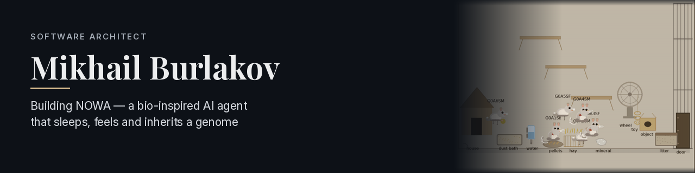
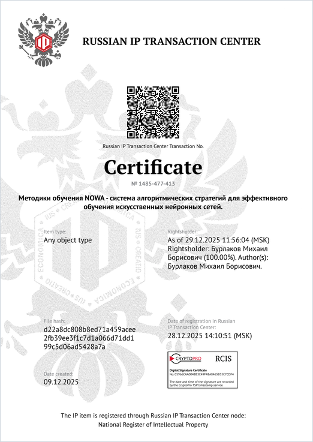
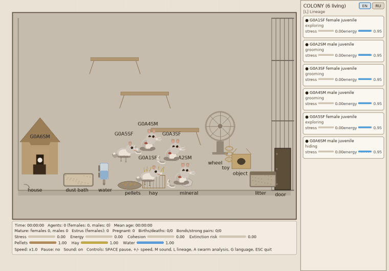

<strong>English</strong> · <a href="README.ru.md">Русский</a>

 

 

 

* 🧠 Building [NOWA](https://github.com/burlakovmb/NOWA-Bio-Inspired-AI) — a bio-inspired cognitive AI agent that sleeps, feels and inherits a genome. It learns only during sleep (TD learning, no backprop).

* 💻 Software Architect in the 1C ecosystem.

* 🛠️ [17 agent skills](https://github.com/burlakovmb/AIAgentSkillsFor1CEDT) for Cursor and Claude Code to write 1C:EDT code to 1C (ITS) standards.

* 📜 Authorship of the NOWA training methods is deposited in the Russian IP Transaction Center (National Register of Intellectual Property), certificate No. 1485-477-413, 28 December 2025. [Certificate (PDF)](certificates/NOWA_certificate_1485-477-413.pdf) · [Appendix (PDF)](certificates/NOWA_certificate_1485-477-413_deposit_appendix.pdf)

  

* ✍️ Article (RU): [Сутки из жизни G3A1SF: как я учу агента без backprop — днём он живёт, ночью учится](https://habr.com/ru/articles/1095790/).

<h3>🧠 NOWA</h3>

  

A cognitive architecture with neuromodulators (DA, 5HT, NE, ACh, cortisol), an 8-dimensional affective space where emotions are attractors, Go/NoGo basal ganglia channels, and episodic memory recombined into imagined trajectories during sleep. Agents inherit a 39-gene genome and an epigenome. The demo is an evolving chinchilla colony.

NOWA is source available for reading and running, free for research and non-commercial use under the <a href="https://polyformproject.org/licenses/strict/1.0.0">PolyForm Strict License 1.0.0</a>.

<table style="table-layout:fixed;width:100%">
<colgroup>
  <col style="width:40%">
  <col style="width:16%">
  <col style="width:44%">
</colgroup>
<tr><th>Title</th><th>Stars</th><th>Tech / Links</th></tr>
<tr>
  <td><a href="https://github.com/burlakovmb/NOWA-Bio-Inspired-AI">NOWA — Bio-Inspired AI</a></td>
  <td></td>
  <td>
    
    
    
  </td>
</tr>
</table>

<h3>🛠️ 1C and other work</h3>

<table style="table-layout:fixed;width:100%">
<colgroup>
  <col style="width:40%">
  <col style="width:16%">
  <col style="width:44%">
</colgroup>
<tr><th>Title</th><th>Stars</th><th>Tech / Links</th></tr>
<tr>
  <td><a href="https://github.com/burlakovmb/AIAgentSkillsFor1CEDT">Agent skills for 1C:EDT</a></td>
  <td></td>
  <td>
    
    
    
  </td>
</tr>
<tr>
  <td><a href="https://github.com/burlakovmb/Claude-AI-assistant-for-1C">Claude AI assistant for 1C</a></td>
  <td></td>
  <td>
    
    
  </td>
</tr>
<tr>
  <td><a href="https://github.com/burlakovmb/OneAI">One AI</a></td>
  <td></td>
  <td>
    
  </td>
</tr>
<tr>
  <td><a href="https://github.com/burlakovmb/CheckDeclarationsRO">Declarations Checking (DUK-Integrator)</a></td>
  <td></td>
  <td>
    
    
  </td>
</tr>
</table>

