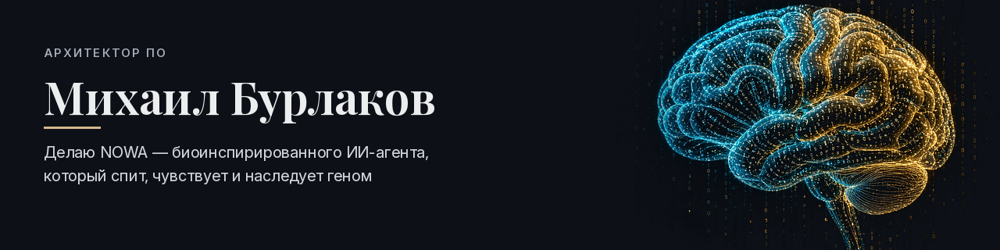
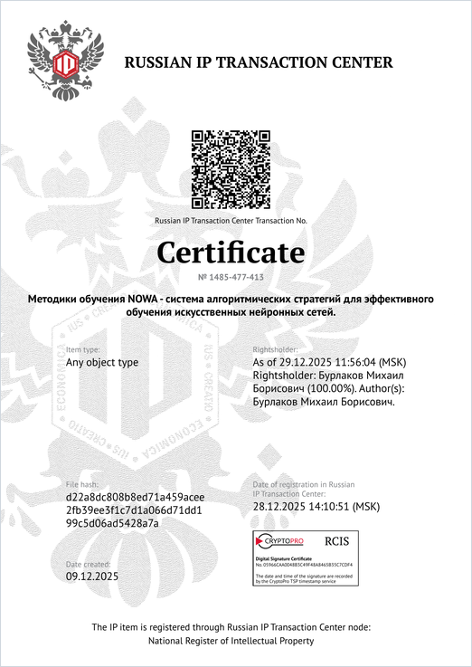
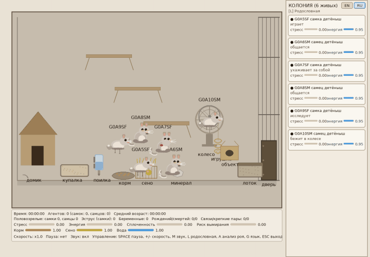

<a href="README.md">English</a> · <strong>Русский</strong>

 

 

 

* 🧠 Делаю [NOWA](https://github.com/burlakovmb/NOWA-Bio-Inspired-AI) — биоинспирированного когнитивного ИИ-агента, который спит, чувствует и наследует геном. Он обучается только во сне (TD-обучение, без backprop).

* 💻 Архитектор программного обеспечения в экосистеме 1С.

* 🛠️ [17 скилов](https://github.com/burlakovmb/AIAgentSkillsFor1CEDT) для Cursor и Claude Code: код в формате 1C:EDT по стандартам 1С (ИТС).

* 📜 Авторство методик обучения NOWA депонировано в РЦИС (Russian IP Transaction Center, Национальный реестр интеллектуальной собственности), свидетельство № 1485-477-413 от 28 декабря 2025 г. [Свидетельство (PDF)](certificates/NOWA_certificate_1485-477-413.pdf) · [Приложение (PDF)](certificates/NOWA_certificate_1485-477-413_deposit_appendix.pdf)

  

* ✍️ Статья на Хабре: [Сутки из жизни G3A1SF: как я учу агента без backprop — днём он живёт, ночью учится](https://habr.com/ru/articles/1095790/).

<h3>🧠 NOWA</h3>

  

Когнитивная архитектура с нейромодуляторами (DA, 5HT, NE, ACh, кортизол), восьмимерным аффективным пространством, в котором эмоции — аттракторы, каналами Go/NoGo базальных ганглиев и эпизодической памятью, которая во сне рекомбинируется в воображаемые траектории. Агенты наследуют геном из 39 генов и эпигеном. Демонстрация — эволюционирующая колония шиншилл.

NOWA доступна в исходных текстах для чтения и запуска, бесплатно для исследований и некоммерческого использования, по лицензии <a href="https://polyformproject.org/licenses/strict/1.0.0">PolyForm Strict License 1.0.0</a>.

<table style="table-layout:fixed;width:100%">
<colgroup>
  <col style="width:40%">
  <col style="width:16%">
  <col style="width:44%">
</colgroup>
<tr><th>Название</th><th>Звёзды</th><th>Технологии / ссылки</th></tr>
<tr>
  <td><a href="https://github.com/burlakovmb/NOWA-Bio-Inspired-AI">NOWA — биоинспирированный ИИ</a></td>
  <td></td>
  <td>
    
    
    
  </td>
</tr>
</table>

<h3>🛠️ 1С и другие работы</h3>

<table style="table-layout:fixed;width:100%">
<colgroup>
  <col style="width:40%">
  <col style="width:16%">
  <col style="width:44%">
</colgroup>
<tr><th>Название</th><th>Звёзды</th><th>Технологии / ссылки</th></tr>
<tr>
  <td><a href="https://github.com/burlakovmb/AIAgentSkillsFor1CEDT">Скилы для 1C:EDT</a></td>
  <td></td>
  <td>
    
    
    
  </td>
</tr>
<tr>
  <td><a href="https://github.com/burlakovmb/Claude-AI-assistant-for-1C">Claude AI-ассистент для 1С</a></td>
  <td></td>
  <td>
    
    
  </td>
</tr>
<tr>
  <td><a href="https://github.com/burlakovmb/OneAI">One AI</a></td>
  <td></td>
  <td>
    
  </td>
</tr>
<tr>
  <td><a href="https://github.com/burlakovmb/CheckDeclarationsRO">Проверка деклараций (DUK-Integrator)</a></td>
  <td></td>
  <td>
    
    
  </td>
</tr>
</table>

